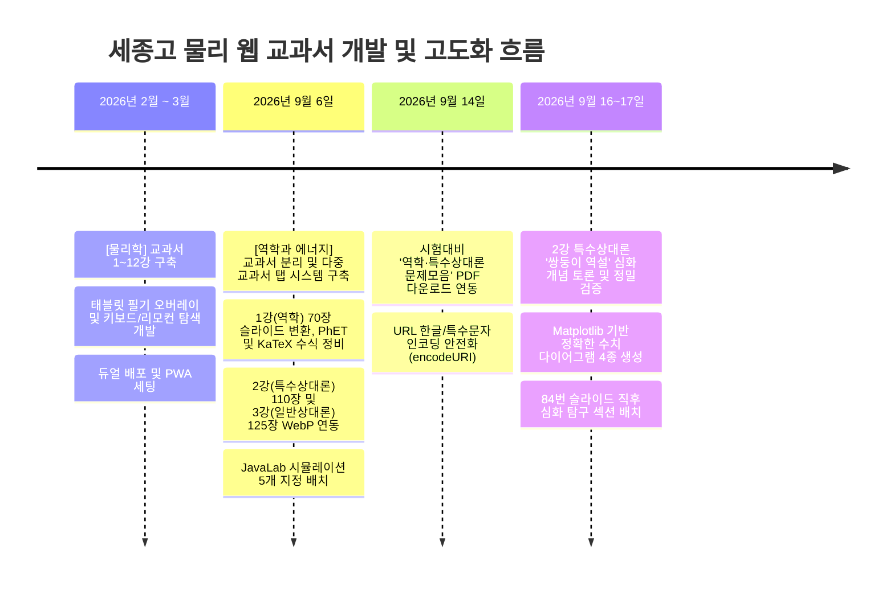

# 📘 세종고 물리 웹 교과서 프로젝트 인수인계서 (Master Handover Guide)

> **프로젝트 명**: 세종고등학교 스마트 물리 웹 교과서 (`sejongphysics`)  
> **운영 도메인**: [https://sejongphysics.co.kr](https://sejongphysics.co.kr)  
> **저장소**: [GitHub wawosuho-sketch/sejongphysics](https://github.com/wawosuho-sketch/sejongphysics)  
> **기술 스택**: Svelte 5, Vite, KaTeX, VitePWA, HTML5 Canvas, GitHub Actions (GitHub Pages 배포)  
> **타겟 사용자**: 세종고등학교 학생 (주로 태블릿 환경) 및 교사

---

## 📑 목차
1. [프로젝트 개요 및 목적](#1-프로젝트-개요-및-목적)
2. [전체 작업 흐름 및 연대기 (Chronological History)](#2-전체-작업-흐름-및-연대기)
3. [작업 과정에서 얻은 핵심 교훈 (Lessons Learned & Golden Rules)](#3-작업-과정에서-얻은-핵심-교훈)
4. [시스템 아키텍처 및 핵심 코드 구조](#4-시스템-아키텍처-및-핵심-코드-구조)
5. [데이터 스키마 및 슬라이드 구조](#5-데이터-스키마-및-슬라이드-구조)
6. [신규 강의 추가 및 업데이트 표준 절차 (SOP)](#6-신규-강의-추가-및-업데이트-표준-절차-sop)
7. [현재 상태 및 향후 잔여 작업 (Next Steps)](#7-현재-상태-및-향후-잔여-작업)

---

## 1. 프로젝트 개요 및 목적

본 프로젝트는 세종고등학교 물리학 정규 수업 및 방과후/자습 시간에 활용되는 **디지털 인터랙티브 교과서 웹 애플리케이션**입니다.

### 핵심 특징
- **멀티 교과서 체계**: `물리학 (1~12강)` 및 `역학과 에너지 (1~4강)` 지원.
- **슬라이드 스트리밍 뷰어**: PPT 강의 슬라이드를 고화질 WebP 이미지로 렌더링하고, 슬라이드 사이사이에 **PhET/JavaLab(자바실험실) 시뮬레이션**, **유튜브 개념 영상**, **KaTeX 수식 요약(Callout)**, **개념 점검 퀴즈(ToggleQuiz)**를 결합.
- **태블릿 전용 인터랙션**:
  - 화면 위 자유 필기 오버레이 기능 (`CanvasOverlay`, 펜/형광펜/지우개).
  - 로컬스토리지 기반 슬라이드별 필기 JPEG 압축 저장.
  - 수업용 무선 리모컨 및 키보드 단축키 지원 (D: 필기 모드, F: 전체화면, 방향키: 슬라이드 이동).
- **자동 배포 파이프라인**: Git `main` 브랜치 푸시 시 GitHub Actions를 통해 빌드 및 배포 자동화.

---

## 2. 전체 작업 흐름 및 연대기



### 단계별 상세 작업 내역

#### Phase 1: 초기 단일 교과서 구축 (2026년 2~3월)
- **대상**: `물리학` 1강(물리학이란)~12강(빛의 입자성) 총 12개 강의.
- **주요 구현**:
  - PPT를 캡처하여 WebP로 변환 후 `public/images/lecture_XX/`에 보관.
  - Svelte 기반 반응형 슬라이드 뷰어(`LecturePage.svelte`) 및 하단 스크러버(Scrubber) 바 개발.
  - 학생/교사 수업 편의를 위한 캔버스 오버레이(`CanvasOverlay.svelte`, `whiteboardStore.js`) 개발.
  - 지우개 두께 이슈, 투명도 버그, 로컬스토리지 용량 한계 개선(JPEG 압축 저장).
  - PWA (`vite-plugin-pwa`) 적용으로 오프라인 캐싱 지원.

#### Phase 2: 다중 교과서 지원 체계로의 대개편 (2026년 9월 6일)
- **요구사항**: 기존 `물리학` 외에 새로운 과목인 `역학과 에너지` 교과서를 추가 분리하여 운영.
- **작업 내용**:
  1. `src/lib/data/textbooks.js` 메타데이터 파일 신설: 교과서 목록(`physics`, `mechanics`)과 강의 커리큘럼, 과제 URL, 문제 PDF 경로를 중앙 집중 관리.
  2. `Home.svelte` 개편: 상단 네비게이션 탭(`[물리학]`, `[역학과 에너지]`) 추가, 탭 전환 시 강의 카드 및 문제 다운로드 카드 동적 전환.
  3. 상태 유지(Persistence): 브라우저 `localStorage` 및 URL 쿼리 파라미터(`?book=mechanics&page=lecture_mech_01`)를 연동하여 강의 시청 후 목록으로 돌아왔을 때 기존 교과서 탭이 유지되도록 수정.

#### Phase 3: [역학과 에너지] 1강 (역학) 고도화 및 시행착오 (2026년 9월 6일)
- **자료**: 구글 슬라이드 70장 분량 (벡터, 포물선, 원운동, 에너지 보존, 단진자).
- **진행 과정 & 시행착오**:
  - 초기에 70장을 텍스트 요약본으로 변환 시도 -> 수식 및 그림 손실로 사용자 반려.
  - 슬라이드 70장을 2.0배 고해상도 WebP(`slide_01.webp` ~ `slide_70.webp`)로 렌더링 후 `public/images/slides/mech_01/`에 저장.
  - AI가 임의로 다크모드 글래스모피즘으로 슬라이드 전체를 재디자인하고 'Click-to-Zoom(클릭 확대 모달)'을 추가했으나, **사용자 피드백으로 전면 롤백**. (학생 태블릿 환경에서 팝업이 번거롭고 제스처를 방해함).
  - 텍스트 및 수식에 `$m=2\text{kg}$` 형태로 raw 텍스트가 노출되는 버그 발견 -> `katexHelper.js` 유틸리티 제작 후 전역 적용.

#### Phase 4: [역학과 에너지] 2강 & 3강 구축 (2026년 9월 6일)
- **2강 (특수상대성이론, 110장)**:
  - 110장 슬라이드 WebP 추출 (`public/images/slides/mech_02/`).
  - 사용자가 지정한 JavaLab 시뮬레이션 5개(동시성의 상대성, 특수상대론 1/2, 시공간, 쌍둥이 역설)를 특정 슬라이드(37, 44, 54, 69, 74) 직후에 정확히 배치.
- **3강 (일반상대성이론, 125장)**:
  - 125장 슬라이드 WebP 추출 (`public/images/slides/mech_03/`).
  - Slide 114 직후 JavaLab 중력 렌즈 시뮬레이션 및 파트별 퀴즈 배치.
- **메인 홈 액션 센터 조정**: 교과서 커리큘럼에 집중할 수 있도록 과제 제출/문제 모음 카드를 일시 숨김 처리.

#### Phase 5: 시험기간 문제 다운로드 기능 복원 및 안정화 (2026년 9월 14일)
- **요구사항**: `역학,특수상대론 문제모음.pdf` 파일을 학생들이 다운로드할 수 있도록 액션 센터 복원.
- **작업 내용**:
  - `textbooks.js`에 `mech_relativity_problems` 항목 추가.
  - 파일명에 포함된 한글 및 쉼표(`,`)가 모바일(카카오톡 인앱 브라우저, iOS 사파리 등)에서 깨지는 문제를 방지하기 위해 `encodeURI(import.meta.env.BASE_URL + ...)` 적용.

#### Phase 6: 2강 쌍둥이 역설 심화 탐구 슬라이드 및 다이어그램 구축 (2026년 9월 16~17일)
- **배경**: 사용자가 "우주선 입장에서 왜 0.5배속/2.0배속이 되는지, 가속도 없는 3인 관찰자 모델(6광년 떨어진 곳에서 출발하는 우주선 B)에서 왜 10년이 되는지"에 대한 학생 대상 심화 설명 슬라이드 제작 요청.
- **물리적 핵심 정리**:
  1. 지구 관점: A(지구)와 B(6광년)가 $t=0$ 동시 출발 $\to$ 5년 후 3광년 행성에서 교차 $\to$ 5년 후 지구 도착 = **총 10.0년**.
  2. 우주선 B 관점: 동시성의 상대성에 의해 지구 시계가 이미 **3.6년** 앞선 상태에서 출발 $\to$ 행성까지 4년 비행(지구 시계 +3.2년)으로 교차 시 지구 시계 **6.8년** $\to$ 지구까지 4년 비행(지구 시계 +3.2년)으로 최종 도착 시 지구 시계 **10.0년** ($3.6 + 3.2 + 3.2 = 10.0$).
  3. 동시성의 2가지 기준: 사전 약속(지구에서 빛을 쏴 $6\text{광년}$ 시계 동기화) vs 물리적 검증(중앙 행성 $3\text{광년}$ 관측자가 양쪽 빛 동시 수신).
- **시행착오 및 해결**:
  - 처음 AI 이미지 생성 툴로 그린 SF풍 일러스트는 물리적 치수(3광년, 2.4광년 등) 텍스트가 뭉개져 실격.
  - Python Matplotlib 스크립트(`scripts/generate_twin_diagrams.py`)를 직접 작성하여 치수, 한글 라벨, 좌표가 정밀하게 표기된 다이어그램 4장 생성.
  - 슬라이드 삽입 위치가 PPT 99번(웹 인덱스 120번)이 아닌, 실제 배속 설명이 끝나는 PPT 84번 직후여야 함을 확인하고 `mech_02.js`에서 위치 재조정.

---

## 3. 작업 과정에서 얻은 핵심 교훈

새로운 AI 작업자나 개발자가 반드시 지켜야 할 **골든 룰(Golden Rules)**입니다.

> [!CAUTION]
> ### 1. 슬라이드 원본 이미지를 AI가 임의로 재디자인하지 말 것
> 교사용 지도서 및 발표 원본 슬라이드는 다년간 검증된 학습 레이아웃입니다. AI가 임의로 다크모드 글래스모피즘 등으로 재구성하면 수식 폰트 왜곡, 가독성 저하, 교사의 강의 흐름 훼손을 초래합니다.  
> **원칙**: 구글 슬라이드/PDF 원본을 있는 그대로 2.0배율 고해상도 WebP(`slide_XX.webp`)로 변환하여 배치할 것.

> [!IMPORTANT]
> ### 2. 태블릿 UX 우선주의 (불필요한 팝업/확대 모달 금지)
> 주 사용 기기는 학생들의 태블릿(iPad, Galaxy Tab)입니다.  
> - 이미지를 탭했을 때 풀스크린 팝업이 뜨는 Click-to-Zoom 기능은 펜 필기나 스크롤 제스처와 충돌하여 사용성을 심각하게 해칩니다 (과거 작업에서 전면 제거됨).
> - 모든 인터랙션은 **단일 수직 스크롤 스트림** 안에서 자연스럽게 완결되어야 합니다.

> [!TIP]
> ### 3. 물리 도식은 생성형 AI 이미지가 아닌 Python(Matplotlib/SVG)으로 작성
> 생성형 이미지 모델(DALL-E, Imagen 등)은 정확한 한글 라벨과 물리 수치(예: $3\text{광년}$, $0.6c$, 화살표 길이)를 렌더링하지 못하고 외계어로 뭉갭니다.  
> **원칙**: 정밀한 다이어그램이 필요할 때는 반드시 `scripts/generate_twin_diagrams.py`처럼 **Python Matplotlib 스크립트**를 작성해 정확한 좌표계와 한글 폰트를 지정하여 PNG/WebP로 생성하십시오.

> [!WARNING]
> ### 4. KaTeX 수식 파싱 누락 주의
> `Callout.svelte`, `ToggleQuiz.svelte`, `LecturePage.svelte` 등에서 수식을 출력할 때 반드시 `src/lib/utils/katexHelper.js`의 `formatMathText()`를 거쳐야 합니다.  
> - `<slot />`이나 단순 문자열로 바인딩하면 `$E=mc^2$`처럼 `$` 달러 기호와 원문이 그대로 노출됩니다.
> - `formatMathText()`는 `$...$`(인라인) 및 `$$...$$`(블록) 수식을 HTML로 변환합니다.

> [!NOTE]
> ### 5. 배포 후 캐시
> 앱 껍데기(JS/CSS)는 서비스 워커 `autoUpdate`로 다음 방문 때 바뀝니다. `registerSW`의 `onNeedRefresh`를 비워 두지 마십시오. 비어 있으면 자동 갱신이 멈춥니다.
> 슬라이드 이미지는 사전 캐시에 넣지 않고, 한 번 본 이미지만 `StaleWhileRevalidate`로 저장합니다. 학교 와이파이에서 교과서 전체를 미리 받지 않기 위해서입니다. 방금 고친 슬라이드가 옛 그림으로 보이면 그 페이지만 새로고침하면 됩니다.

> [!IMPORTANT]
> ### 6. 슬라이드 번호의 '이중 체계' 이해
> 사용자가 "84번 슬라이드 뒤에 넣어줘"라고 할 때, 이는 **원본 PPT 파일** `slide_84.webp`를 의미합니다. 하단 스크러버의 큰 숫자는 퀴즈·시뮬레이션이 끼어 더 큽니다. 이미지 슬라이드에 올라가면 스크러버에 **원본 84**가 함께 표시됩니다.
> 삽입 위치는 스트림 순번이 아니라 `src` 파일명으로 잡습니다. 필기도 파일명 키로 저장되므로, 퀴즈를 사이에 넣어도 학생 필기가 밀리지 않습니다.

---

## 4. 시스템 아키텍처 및 핵심 코드 구조

### 디렉터리 트리 요약
```
r:\textbook-svelte\
├── .github/workflows/deploy.yml   # GitHub Actions 자동 배포 (main 푸시 시 dist -> gh-pages)
├── public/
│   ├── images/
│   │   ├── lecture_1~12/          # [물리학] 1~12강 슬라이드 WebP
│   │   ├── slides/
│   │   │   ├── mech_01/           # [역학과 에너지] 1강 슬라이드 (slide_01~70.webp)
│   │   │   ├── mech_02/           # [역학과 에너지] 2강 슬라이드 (slide_01~114.webp 및 다이어그램)
│   │   │   └── mech_03/           # [역학과 에너지] 3강 슬라이드 (slide_01~125.webp)
│   │   └── thumbnails/            # 교과서별 강의 썸네일
│   └── resources/                 # 시험 대비 문제 및 해설 PDF 파일들
├── scripts/
│   ├── convert_pdf_slides.py      # PDF -> 2.0x 고해상도 WebP 자동 변환 도구
│   ├── generate_twin_diagrams.py  # 쌍둥이 역설 정밀 다이어그램 생성 스크립트
│   └── optimize-images.js         # 이미지 압축 스크립트
├── src/
│   ├── lib/
│   │   ├── components/
│   │   │   ├── CanvasOverlay.svelte   # 슬라이드 위 투명 필기 캔버스
│   │   │   ├── DrawingToolbar.svelte  # 펜/형광펜/지우개/색상 선택 툴바
│   │   │   ├── Simulation.svelte      # iframe 임베드 래퍼 (PhET, JavaLab)
│   │   │   ├── Video.svelte           # YouTube 영상 임베드 래퍼
│   │   │   ├── ToggleQuiz.svelte      # 정답 토글형 퀴즈 카드 (KaTeX 렌더링)
│   │   │   └── Callout.svelte         # 개념 강조/요약 박스 (KaTeX 렌더링)
│   │   ├── data/
│   │   │   ├── textbooks.js           # [핵심] 교과서 및 전체 강의 메타데이터 마스터
│   │   │   ├── lecture_01~12.js       # [물리학] 강의별 슬라이드 데이터
│   │   │   └── mech_01~04.js          # [역학과 에너지] 강의별 슬라이드 데이터
│   │   ├── pages/
│   │   │   ├── Home.svelte            # 메인 홈 (교과서 선택 탭, 커리큘럼, 액션센터)
│   │   │   └── LecturePage.svelte     # 강의 뷰어 (스트림 뷰어, 스크러버, 키보드 리모컨)
│   │   ├── stores/
│   │   │   └── whiteboardStore.js     # 필기 상태. 파일명 키로 WebP/PNG 저장
│   │   └── utils/
│   │       └── katexHelper.js         # KaTeX 수식 변환 파서
│   ├── App.svelte                     # URL 쿼리 동기화 및 전역 라우터
│   └── main.js
├── vite.config.js                     # Vite 설정 및 PWA 플러그인
└── package.json
```

### 라우팅 및 상태 동기화 매커니즘 (`App.svelte`)
- SPA 환경에서 히스토리 API와 URL Search Params를 사용하여 상태를 제어합니다:
  - `sejongphysics.co.kr/?book=physics`: 물리학 교과서 홈
  - `sejongphysics.co.kr/?book=mechanics`: 역학과 에너지 교과서 홈
  - `sejongphysics.co.kr/?book=mechanics&page=lecture_mech_02&slide=84`: 역학과 에너지 2강 84번 슬라이드 직접 접근
- 강의 뷰어(`LecturePage.svelte`)에서 `← 전체 목록으로 돌아가기`를 누르면 `navigate("home", 1, currentBookId)`를 호출하여, **기존에 보던 교과서 탭이 그대로 유지**된 채 홈으로 복귀합니다.

### 필기(Whiteboard) 시스템 원리
- 모든 슬라이드 아이템 위에 투명 HTML5 Canvas(`CanvasOverlay.svelte`)가 겹쳐져 있습니다.
- 단축키 `D`를 누르면 `whiteboardStore.isDrawingMode`가 토글되어 캔버스에 마우스/터치 필기가 가능해집니다.
- 필기는 투명도가 필요하므로 JPEG가 아니라 WebP(미지원 브라우저는 PNG)로 줄여 `localStorage`(`textbookLayoutDrawings`)에 저장합니다. 키는 스트림 순번이 아니라 이미지 파일명입니다. 용량이 가득 차면 툴바가 내보내기를 안내합니다.

---

## 5. 데이터 스키마 및 슬라이드 구조

### 1) 교과서 마스터 스키마 (`src/lib/data/textbooks.js`)
```javascript
export const textbooks = [
  {
    id: "mechanics",                 // 고유 식별자 (URL 쿼리 ?book=... 매핑)
    name: "역학과 에너지",
    badge: "MECHANICS & ENERGY",
    description: "물체의 운동과 에너지를 탐구하는 역학과 에너지 교과서",
    school: "세종고등학교",
    homeworkUrl: "https://clipo.ai/students/homeworks/...", // 과제 제출 링크
    problems: [
      {
        id: "mech_relativity_problems",
        title: "역학·특수상대론 문제모음",
        pdf: "resources/역학,특수상대론 문제모음.pdf"       // public/resources 상대경로
      }
    ],
    lectures: [
      {
        id: "mech_01",
        fullId: "mech_01",
        title: "1강. 역학과 에너지 (역학 파트 전체)",
        subtitle: "벡터, 포물선, 원운동, 에너지 보존, 단진자의 완벽한 통합",
        tag: "I. 역학 파트",
        image: "/images/thumbnails/mech_01.webp",
        accent: "#ef4444"
      },
      // ...
    ]
  }
];
```

### 2) 강의 데이터 아이템 스키마 (`src/lib/data/mech_XX.js`)
`lectureData` 배열에 순서대로 선언된 객체들이 위에서 아래로 수직 스트리밍됩니다.

```javascript
export const lectureData = [
  // 1. 대단원 제목
  { type: "title", text: "2강. 특수상대성이론" },

  // 2. 소단원 분리 배너
  {
    type: "section_header",
    chapter: "PART 1",
    title: "Ⅰ. 상대성 원리의 보편성",
    subtitle: "갈릴레이 상대성 원리와 등속 관성계"
  },

  // 3. 슬라이드 이미지
  { type: "image", src: "/images/slides/mech_02/slide_01.webp" },

  // 4. 공식 요약 및 설명 카드 (KaTeX 지원)
  {
    type: "callout",
    style: "info", // "info", "success", "warning"
    title: "📌 핵심 수식: 로런츠 인자",
    content: "시간 지연 공식: $\\Delta t = \\gamma \\Delta t_0$, 여기서 $\\gamma = \\frac{1}{\\sqrt{1 - v^2/c^2}}$"
  },

  // 5. 시뮬레이션 임베드 (PhET, JavaLab)
  {
    type: "simulation",
    title: "🕹️ 직접 탐구: 동시성의 상대성 (자바실험실)",
    src: "https://javalab.org/ko/relativity_of_simultaneity/",
    height: "650"
  },

  // 6. 개념 점검 퀴즈 (정답 토글형)
  {
    type: "quiz",
    title: "💡 개념 확인 퀴즈",
    question: "우주선이 $0.6c$로 이동할 때 지구 관찰자가 본 우주선의 길이는 고유 길이의 몇 배인가?",
    answer: "$\\sqrt{1 - (0.6)^2} = 0.8$배로 수축되어 관측됩니다."
  },

  // 7. 추천 유튜브 영상
  {
    type: "video",
    title: "뉴턴의 대포와 인공위성 궤도",
    src: "https://www.youtube.com/embed/MTjPIIIyztE" // embed 전용 링크
  }
];
```

---

## 6. 신규 강의 추가 및 업데이트 표준 절차 (SOP)

향후 **4강(열역학)을 완성**하거나 **새로운 강의를 추가**할 때 다음 5단계를 그대로 수행하십시오.

### Step 1: 구글 슬라이드/PDF 다운로드 및 WebP 변환
1. 교사가 제공한 구글 슬라이드 URL에서 PDF 내보내기 링크 생성:
   `https://docs.google.com/presentation/d/{PRESENTATION_ID}/export/pdf`
2. PDF 다운로드:
   ```bash
   python -c "import urllib.request; urllib.request.urlretrieve('https://docs.google.com/presentation/d/.../export/pdf', 'r:/textbook-svelte/tmp/presentation_mech04.pdf')"
   ```
3. 슬라이드 WebP 고화질 렌더링. 스크립트에 경로를 하드코딩하지 않습니다.
   ```bash
   python scripts/convert_pdf_slides.py tmp/presentation_mech04.pdf public/images/slides/mech_04 --thumbnail public/images/thumbnails/mech_04.webp
   ```
   - 2.0배 스케일, WebP 품질 82. 해당 폴더의 기존 `slide_XX.webp`만 지우고 다시 만듭니다. 커스텀 도식은 남습니다.
   - `scripts/optimize-images.js`는 PNG를 지우지 않습니다. 원본까지 지우려면 `--delete`가 필요합니다. 쌍둥이 역설 도식 PNG에 이 스크립트를 `--delete`와 함께 돌리지 마십시오.

### Step 2: 강의 데이터 파일 작성 (`src/lib/data/mech_XX.js`)
1. 슬라이드 요약을 검토하여 3~5개의 `PART`로 구조화.
2. `type: "image"` 슬라이드들을 순서대로 배치.
3. 관련 JavaLab이나 PhET 시뮬레이션 링크 확인 및 삽입.
4. 주요 공식 요약 `callout`과 학생 복습용 `quiz` 추가 (KaTeX 수식 문법 적용).

### Step 3: 메타데이터 등록 (`src/lib/data/textbooks.js`)
`textbooks` 배열의 해당 교과서 `lectures`에 강의 정보(ID, 제목, 소제목, 썸네일 경로, 테마 색상)를 등록.

### Step 4: 로컬 빌드 검증
```bash
npm run check
npm run build
```
- `check`는 강의 데이터와 썸네일, 문제 PDF가 `public/`에 실제로 있는지 확인합니다. 없는 썸네일을 `textbooks.js`에 적으면 여기서 실패합니다.
- Vite 빌드가 에러 없이 통과하는지, KaTeX 폰트나 모듈 누락이 없는지 확인합니다.
- `npm run dev`로 `/?book=mechanics&page=lecture_mech_XX`를 열어 슬라이드와 스크러버의 원본 번호가 맞는지 봅니다.

### Step 5: Git 커밋 & 푸시 (자동 배포)
`tmp/`의 PDF와 작업 메모는 커밋하지 않습니다. 슬라이드, 데이터, 메타데이터만 넣습니다.
```bash
git add public/images/slides/mech_04 public/images/thumbnails/mech_04.webp src/lib/data/mech_04.js src/lib/data/textbooks.js
git commit -m "feat: Add Lecture 4 Thermodynamics with XX slides, simulations, and KaTeX math"
git push origin main
```
- GitHub Actions가 **약 1~2분 후** `sejongphysics.co.kr`에 반영합니다.
- 앱 껍데기는 다음 방문 때 자동으로 바뀝니다. 슬라이드 그림만 옛 버전이면 그 강의 페이지를 한 번 새로고침합니다.

---

## 7. 현재 상태 및 향후 잔여 작업

### 1) 현재 완료된 상태
- **물리학 교과서**: 1강~12강 완벽 서비스 중.
- **역학과 에너지 교과서**:
  - `mech_01` (1강): 70장 슬라이드 + PhET 5종 + KaTeX 요약 + 뉴턴의 대포 영상.
  - `mech_02` (2강): 110장 슬라이드 + JavaLab 5종 + **84번 슬라이드 직후 3인 관찰자 모델 정밀 다이어그램 4종 심화 탐구 섹션**.
  - `mech_03` (3강): 125장 슬라이드 + JavaLab 중력렌즈 시뮬레이션 + KaTeX 요약 및 퀴즈.
  - 메인 페이지: 교과서 선택 탭 및 `역학,특수상대론 문제모음.pdf` 다운로드 센터 연동 완료.

### 2) 향후 작업 예정 과제 (Next Tasks)
- **`mech_04.js` (4강. 열역학 법칙과 에너지)**:
  - `mech_04` (4강): 원본 149장. 빈 마지막 장은 제외. 퀴즈는 없고, 흑체 복사·비열·상태 변화·기체·PV 과정·카르노·4행정 시뮬레이션과 스털링 기관 영상을 해당 슬라이드 직후에 넣었다.
- **문제/해설지 추가 일정 관리**:
  - 해설 공개 시각은 `textbooks.js` 각 문제의 `solutionUntil`입니다. 화면 코드에 날짜를 새로 넣지 않습니다.

---
*문서 작성일: 2026-10-18*  
*작성 기준 커밋: `f2b617f` (fix: Move twin paradox deep dive to slide 84)*
